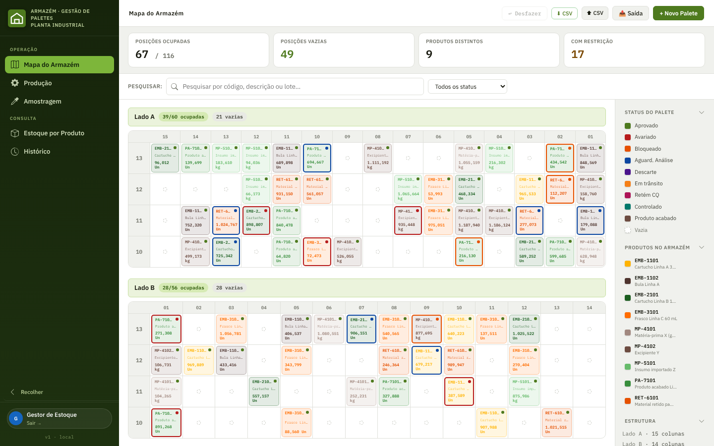
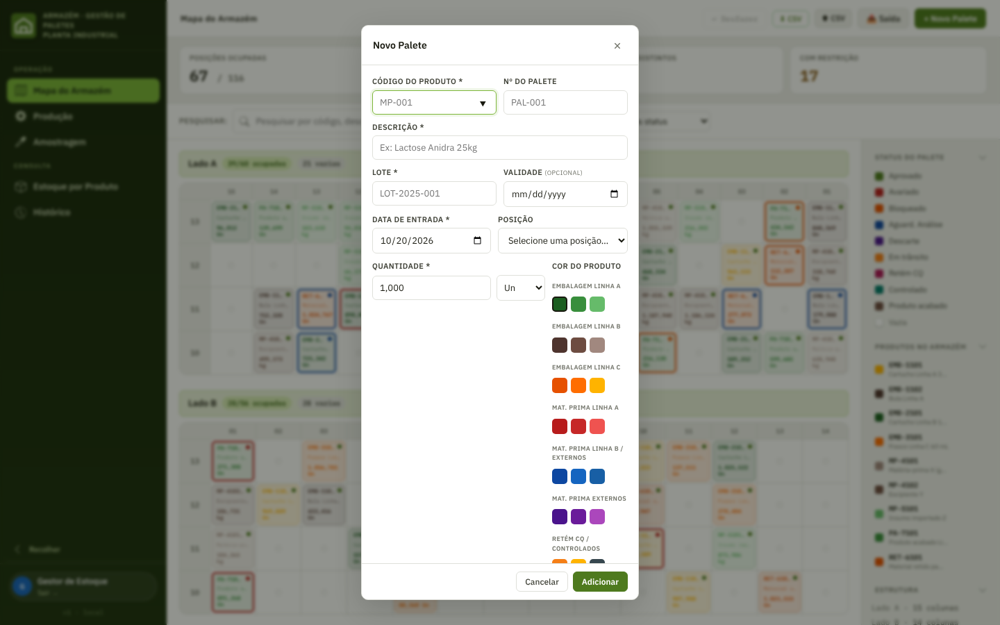
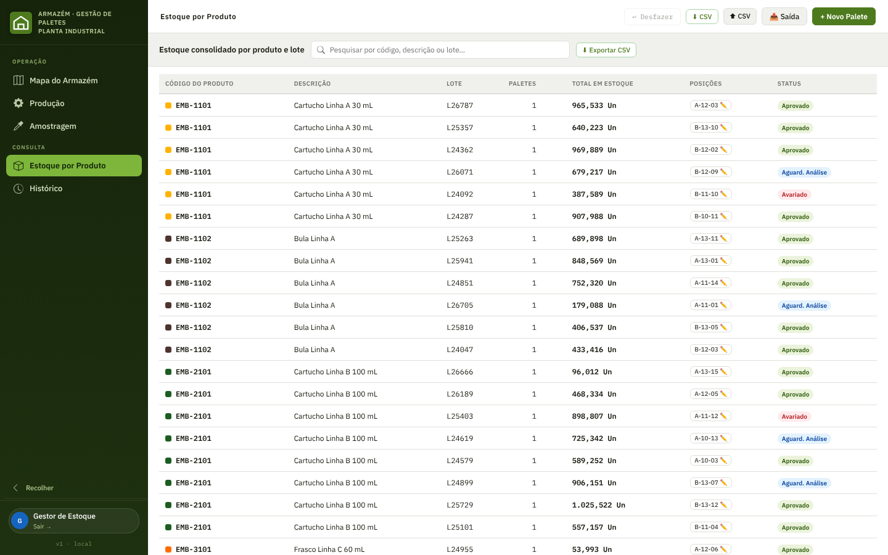
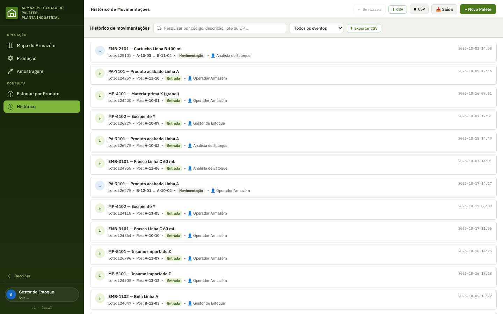
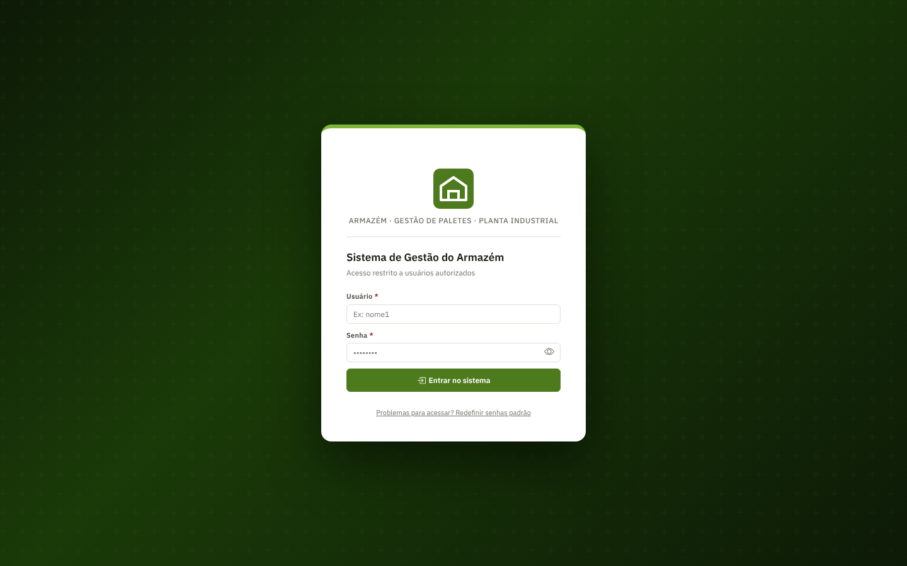

# Gestão de paletes do armazém

**Uma ferramenta para saber onde está cada palete, em que condição e para onde foi.**

| | |
|---|---|
| **Contexto** | Armazém de insumos e embalagens de uma indústria farmacêutica (Grande Barueri – SP) |
| **Meu papel** | Product owner: problema, escopo, regras de negócio, perfis de acesso e prioridades. Desenvolvimento com apoio de IA, sob minha direção |
| **Usuários** | Operador, analista de estoque, gestor de estoque, TI e master |
| **Plataforma** | Aplicação web, acessada pelo navegador |
| **Stack** | HTML/JS, banco em nuvem ou servidor interno, cache local para uso offline |

---

## O problema

Num armazém com muitos produtos, lotes e restrições de qualidade, o custo de não saber onde está um palete é alto: tempo procurando e risco de usar algo que está bloqueado ou aguardando análise. Eu trabalho na operação do almoxarifado, então vi o problema acontecer na prática antes de desenhar a solução.

As perguntas que a ferramenta precisava responder em segundos:

1. **Onde está** este código, este lote?
2. **Em que situação** está: aprovado, bloqueado, avariado, aguardando análise?
3. **Quem mexeu** nele por último e quando?
4. **Quanto tenho** de cada produto, somando todos os paletes e lotes?

## O que eu decidi

### 1. O mapa físico é a interface principal

O armazém tem dois lados, **A (60 posições)** e **B (56 posições)**, com 4 andares cada, num total de **116 posições**. Em vez de uma lista, a tela inicial é o **mapa**: cada célula é uma posição, com a cor do produto e uma borda que indica o status. O operador enxerga o armazém como ele é.

*Telas com dados fictícios.*

### 2. Status de qualidade visíveis na própria posição

Um palete pode estar **aprovado, avariado, bloqueado, aguardando análise ou para descarte**, além das categorias de produto (embalagem, matéria-prima, retido para CQ, controlado, importado e produto acabado). A cor do produto e a borda do status aparecem juntas, então dá para bater o olho no mapa e ver as restrições.

### 3. Fluxos que espelham a rotina real

- **Entrada** de novo palete, com código, lote, validade, quantidade e posição
- **Movimentação** por arrastar e soltar entre posições
- **Saída** para as áreas de **Produção** e **Amostragem**, com a ordem de produção (OP) registrada
- **Devolução** ao estoque do material que não foi usado
- **Etiqueta** do palete para impressão
- **Desfazer** da última ação, porque erro de operação acontece

### 4. Duas visões além do mapa

O **estoque consolidado por produto e lote** responde "quanto tenho", e o **histórico de movimentações** responde "quem fez o quê". A busca é unificada por código, descrição ou lote, e no histórico também por OP.

### 5. Perfis e permissões por responsabilidade

Nem todo mundo deve poder tudo. Defini cinco perfis, com permissões pensadas para separar quem opera de quem decide:

| Ação | Operador | Analista | Gestor | TI | Master |
|---|:-:|:-:|:-:|:-:|:-:|
| Entrada, movimentação, saída e devolução | ✅ | ✅ | ✅ | ✅ | ✅ |
| Editar palete | ✅ | — | ✅ | ✅ | ✅ |
| Alterar status (bloquear, avariar) | — | ✅ | ✅ | ✅ | ✅ |
| Remover palete | — | — | ✅ | ✅ | ✅ |
| Exportar dados | — | ✅ | ✅ | ✅ | ✅ |
| Importar dados | — | — | ✅ | ✅ | ✅ |

A lógica: o **operador** executa, o **analista** classifica a qualidade sem alterar o cadastro, e o **gestor** responde pela integridade dos dados.

### 6. Segurança e confiabilidade como requisito de produto

Ambiente industrial, dados de rastreabilidade: segurança entrou no escopo desde o início.

- **Bloqueio após 5 tentativas** de login inválidas, por 15 minutos
- **Logout automático** após 30 minutos sem uso
- **Registro das tentativas de login**, com exportação para auditoria
- **Senhas com hash**, e validação no servidor quando o modo de servidor interno está ativo
- **Funciona com instabilidade de rede**: cache local, sincronização periódica e aviso de modo offline

## Aprendizados

- **Falha silenciosa é pior que erro visível.** Corrigi um bug em que o login travava sem nenhuma mensagem quando o sistema usava o servidor interno. Desde então, mensagem de erro clara é critério de aceitação nos meus projetos.
- **Perfil por responsabilidade funciona melhor que perfil por cargo.** Separar "quem classifica a qualidade" de "quem edita o cadastro" foi a forma que escolhi de limitar alterações indevidas.
- **Conhecer a operação acelera tudo.** Como eu vivo o almoxarifado, as regras (posições, status, OP, amostragem) saíram do uso real e não de suposição.

<!-- Resultado: acrescente aqui, se puder, 1 dado concreto de uso (ex.: tempo para localizar um palete antes e depois, nº de usuários, nº de movimentações por semana). -->

---

[← Voltar ao portfólio](../../README.md)
