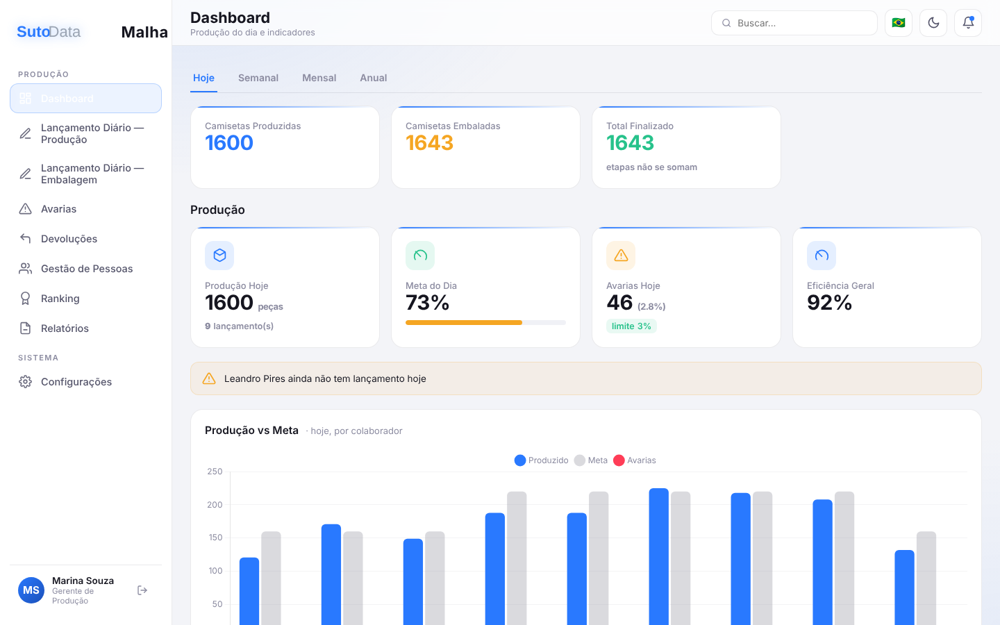
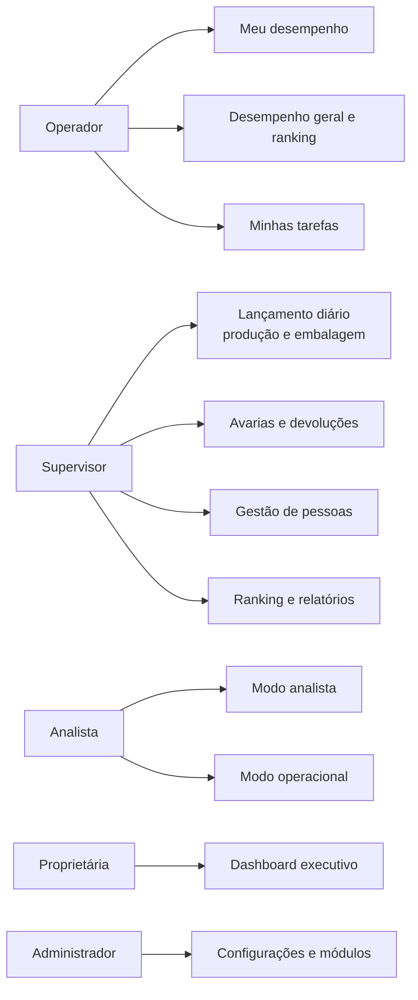
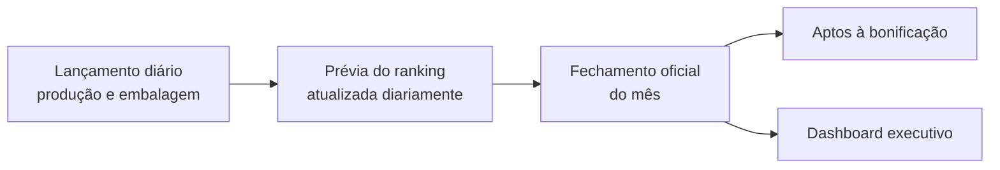
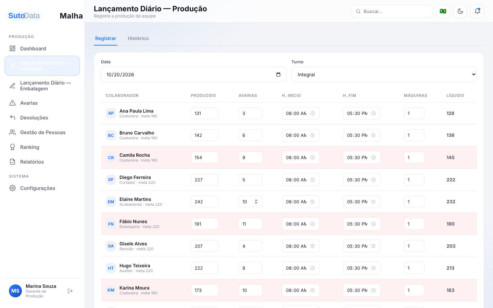
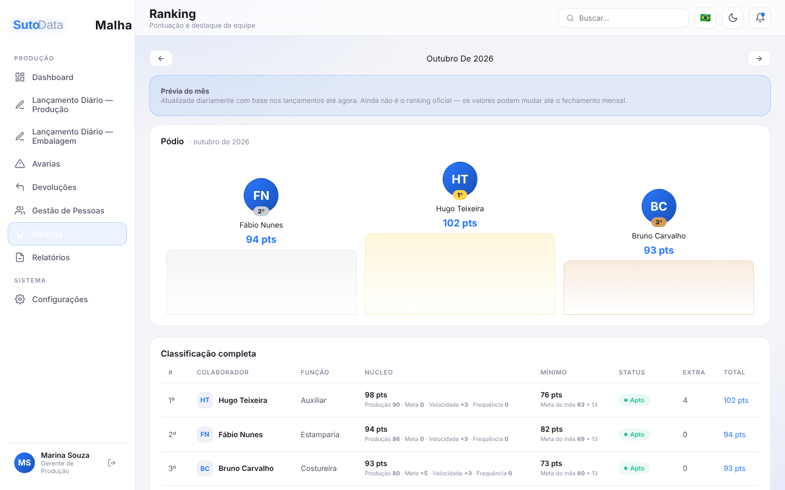
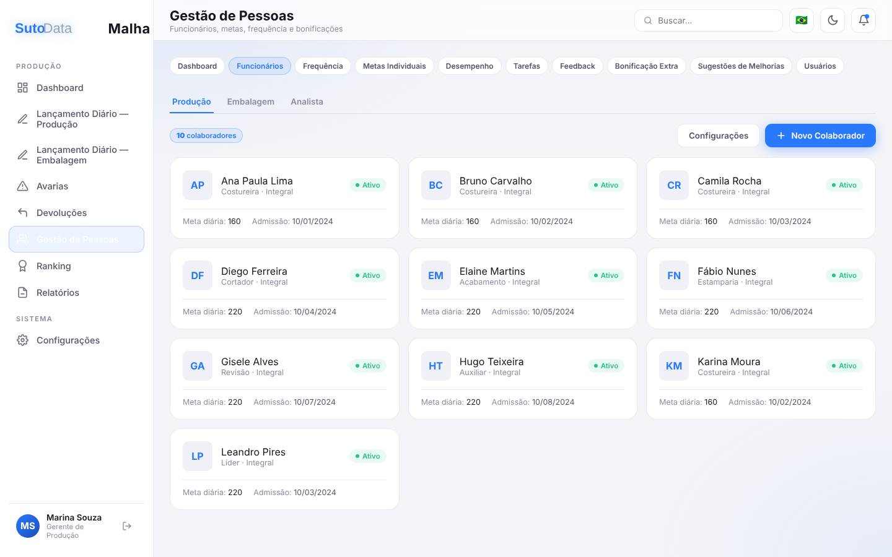
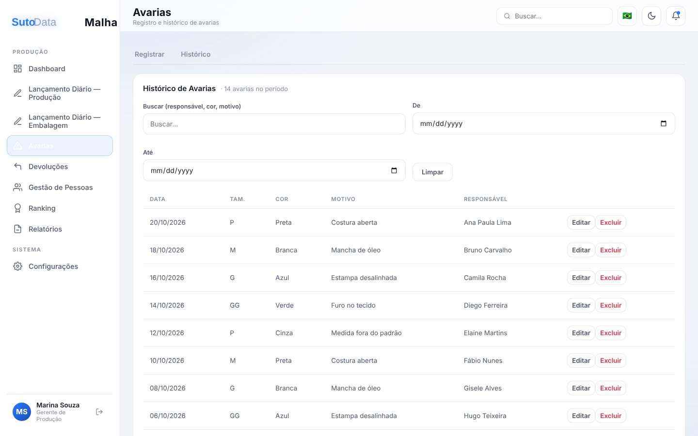
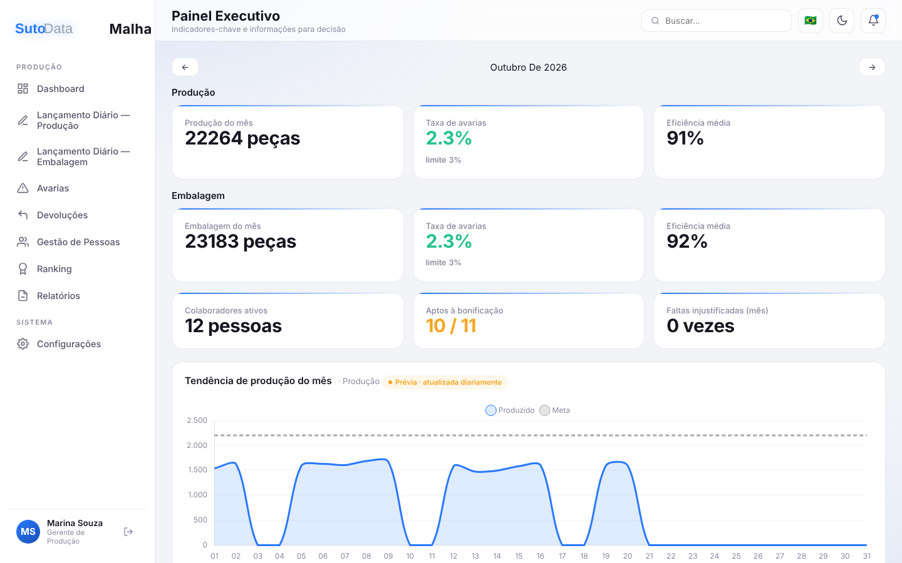

# SutoData — ERP de gestão industrial

**Produção, qualidade, pessoas e visão executiva no mesmo sistema, com um painel para cada perfil.**

| | |
|---|---|
| **Contexto** | ERP multiempresa para gestão de fábrica |
| **Meu papel** | Product owner: escopo, perfis de acesso, regras de negócio e prioridades. Desenvolvimento com agentes de IA, sob minha direção |
| **Usuários** | Operador, analista, supervisor, administrador e proprietária |
| **Plataforma** | PWA (aplicação web instalável no celular), com suporte a 3 idiomas |
| **Stack** | Supabase (banco e regras de negócio) e Netlify |

---

## O problema

Numa fábrica, quem decide precisa ver o mesmo número que quem opera: o que foi produzido no dia, quanto se perdeu em avarias, como cada pessoa está contra a meta e quem merece a bonificação. Quando esses dados vivem em planilhas e papéis separados, o fechamento do mês tende a ser manual e a conversa sobre desempenho perde a base objetiva.

## O que eu decidi

> As telas abaixo usam **dados fictícios** (empresa, pessoas e números inventados).

### 1. Um painel para cada perfil, em vez de um sistema único para todos

Cada perfil enxerga só o que precisa para o seu trabalho:

O **analista** pode alternar entre o modo analítico e o modo operacional, porque na prática ele faz as duas coisas. A **proprietária** vê uma única tela, o dashboard executivo, sem ruído operacional.

### 2. Dado lançado todo dia, fechamento todo mês

O supervisor lança a **produção e a embalagem do dia** contra uma **meta diária**. Os dados alimentam um **ranking** de desempenho. Durante o mês, o ranking aparece como **prévia**, atualizada diariamente. No fim, o **fechamento oficial** define quem está **apto à bonificação**.

A separação entre **prévia** e **oficial** foi uma decisão de produto: o colaborador acompanha como está indo, mas a decisão de bonificação só vale depois do fechamento.

### 3. Qualidade e pessoas no mesmo lugar

- **Avarias** com limite de perda configurável (o padrão é 3%) e **devoluções**
- **Gestão de pessoas**: status do colaborador (ativo, férias, afastado, desligado), frequência e faltas, feedbacks e tarefas
- **Quadro kanban de ideias de melhoria**, para a fábrica registrar sugestões e acompanhar o que foi feito

### 4. Dashboard executivo para quem decide

Uma tela com os números do mês: produção, taxa de avarias contra o limite, eficiência média, colaboradores ativos, aptos à bonificação, faltas injustificadas, principais motivos de avaria e a tendência diária da produção.

### 5. Escopo enxuto, mas preparado para crescer

Esta versão tem foco em **produção**. O sistema também tem módulos comerciais (vendas, funil, clientes, estoque, financeiro, orçamentos, ordens de serviço e comissões), mas eles ficam **desativados por padrão** e podem ser ligados nas configurações. Foi assim que mantive a primeira entrega simples sem fechar a porta para outros clientes.

Por ser **multiempresa**, novas empresas entram por **código de convite**, e há um painel de super administrador para gerenciá-las.

## Como garanti a qualidade

Defini um fluxo de trabalho para o desenvolvimento com IA, com regras de qualidade explícitas:

- **Agentes especializados** (front-end, banco de dados e revisor), com tarefas independentes em paralelo
- **Revisão obrigatória** antes de qualquer publicação, com no máximo 2 ciclos de correção
- **Teste de regressão** para cada bug corrigido: o teste precisa falhar antes da correção e passar depois
- **Simulação (dry run)** antes de mudanças estruturais, como alterar tabelas ou permissões
- **Plano de rollback** pronto antes de mexer em produção

O método completo, com papéis, casos reais e falhas, está em [Modelo operacional: desenvolver com IA sob direção](../../modelo-operacional-ia.md).

## Aprendizados

- **Regra de negócio que gera consequência para a pessoa precisa de um estado "oficial".** A prévia dá transparência, e o fechamento dá segurança.
- **Menos telas por perfil, mais clareza.** Cada perfil vê só o que precisa, e minha aposta é que isso reduz o tempo de treinamento.
- **Disciplina de qualidade é o que torna viável construir rápido com IA.** Revisão e testes de regressão evitam que a velocidade vire retrabalho.

<!-- Resultado: acrescente aqui, se puder, 1 dado concreto (ex.: nº de colaboradores acompanhados, tempo de fechamento do mês antes e depois, status: em produção / em implantação). -->

---

[← Voltar ao portfólio](../../README.md)
