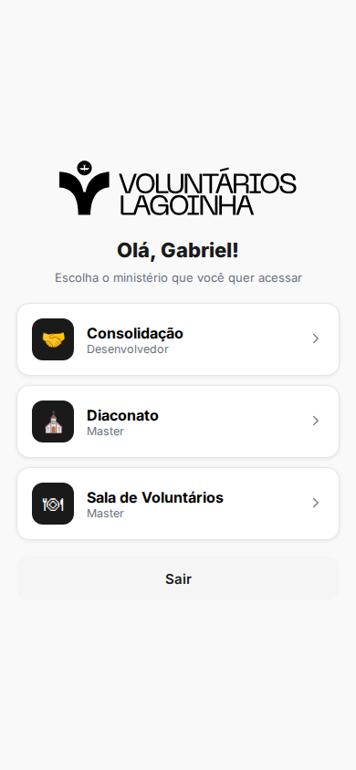
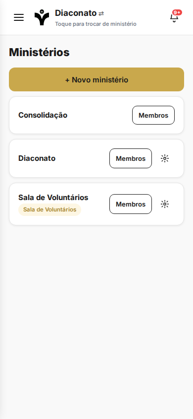
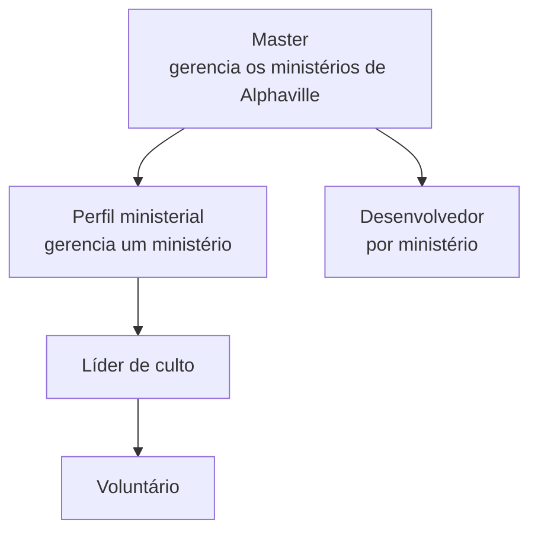
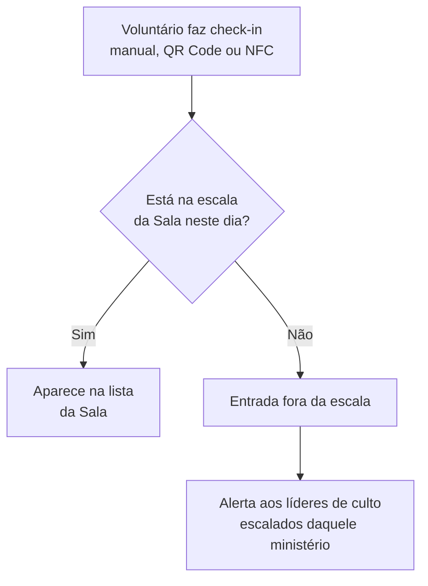
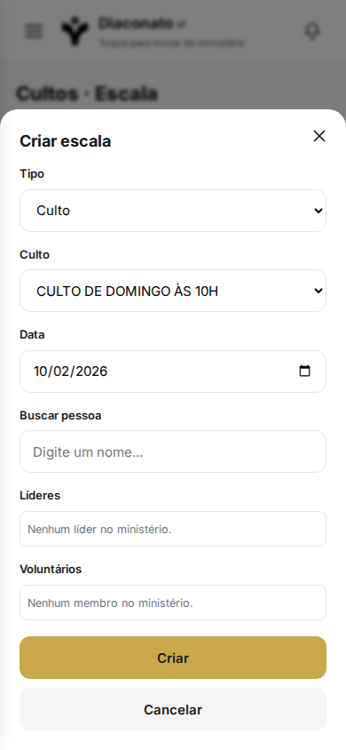
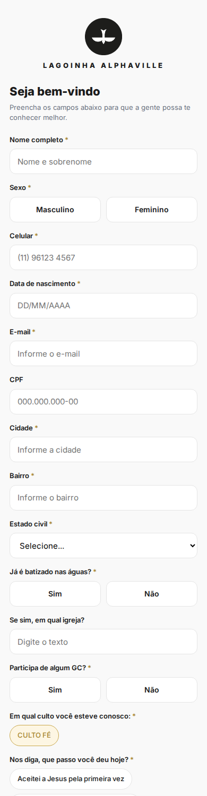
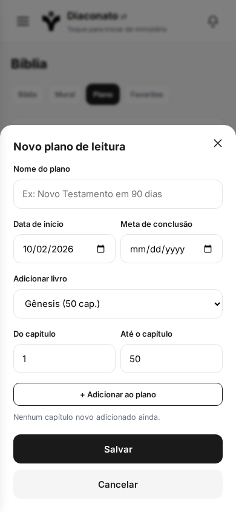
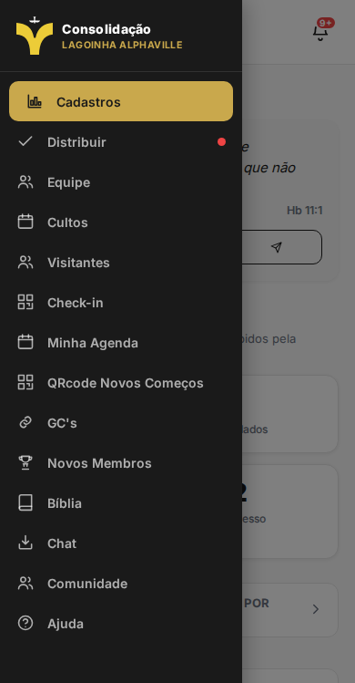

# Voluntários Lagoinha

**Do app da Consolidação, que construí do zero, a uma plataforma para dezenas de ministérios.**

| | |
|---|---|
| **Contexto** | Igreja Lagoinha Alphaville |
| **Meu papel** | Construí do zero o app da Consolidação e conduzi sua expansão para a plataforma de voluntários. Product owner: modelo de produto, hierarquia de acesso, regras, fluxos e documentação para o desenvolvedor responsável pelo deploy. Desenvolvimento com apoio de IA, sob minha direção |
| **Usuários** | Voluntários, líderes de culto, líderes de ministério, pastores e administradores |
| **Plataforma** | PWA, otimizado para celular, com modo tablet |
| **Stack** | Supabase, com ambiente de teste separado da produção |

---

## O problema

Eu construí do zero o app da **Consolidação** (ministério que acolhe e acompanha pessoas novas), e ele funcionava bem para um ministério. Os outros ministérios da igreja, mais de 40 no total, precisavam de algo parecido: saber quem serve, quem foi escalado e quem apareceu.

A pergunta de produto foi: **copiar o app para cada ministério ou transformá-lo numa plataforma?**

## O que eu decidi

### 1. Uma plataforma, não várias cópias

Decidi manter **o mesmo app e o mesmo banco**, com um **seletor de ministério**. Um mesmo usuário pode ter papéis diferentes em ministérios diferentes. Isso evita duplicar manutenção e mantém as informações num só lugar.

### 2. Hierarquia de acesso pensada em camadas

Cada camada vê e altera só o que lhe cabe. Também diferenciei o **Master de Alphaville** do master da rede, que já existia, para que a gestão local não interferisse na central.

### 3. Sala de Voluntários: uma regra que resolve um problema real

O primeiro ministério novo foi a **Sala de Voluntários**, a sala de alimentação de quem serve nos cultos e eventos. O problema é simples: **só quem está escalado e já chegou deve ser atendido**.

A regra vale para os dois lados: o voluntário escalado é atendido sem burocracia, e o fora da escala gera um aviso para os líderes decidirem.

### 4. Check-in e escala como funcionalidades centrais

- **Check-in** por QR Code fixo do ministério, por NFC ou manual (feito pelo líder), com relatório
- **Escala de culto** por ministério, com histórico de alterações
- **Frequência** dos voluntários, para o líder enxergar quem serve e com que constância

### 5. Cadastro público por QR Code

Pessoas novas se cadastram sozinhas por formulários públicos, acessados por QR Code, sem precisar de login. Os dados vão para a fila de acompanhamento da equipe.

### 6. Uma plataforma que vai além da escala

A base de acolhimento e voluntariado ganhou módulos de acompanhamento: **distribuição de contatos entre consolidadores**, **dashboard de novos membros**, **agenda e eventos**, **campanhas de mensagens**, **mapa de GCs** e uma **área de Bíblia** com mural, plano de leitura e favoritos.

### 7. Mapeamento de fluxos antes de construir

Os fluxos, telas e melhorias dos cerca de **42 ministérios** previstos foram mapeados no **Penpot**, antes de cada implementação.

## Como organizei a entrega

- **Ambiente de teste separado da produção.** Nada que eu validava era publicado direto para quem usa.
- **Documento de alterações** para o desenvolvedor responsável por subir as atualizações na produção, com o que mudou e o que verificar.
- **Fluxos e telas mapeados no Penpot**, para que outra pessoa consiga dar continuidade.

## Aprendizados

- **A decisão mais importante foi de modelo, não de tela.** Tratar ministério como uma dimensão do produto, e não como um novo produto, abriu espaço para escalar.
- **Regras claras de quem vê o quê** evitam exposição de dados de pessoas, especialmente em um contexto em que se lida com informações pessoais de membros e visitantes.
- **Handoff é parte do produto.** Quem faz o deploy precisa de contexto, e documentar isso evita erros de produção.

<!-- Resultado: acrescente aqui, se puder, 1 dado concreto (ex.: nº de ministérios ativos na plataforma, nº de voluntários com check-in por mês). -->

---

[← Voltar ao portfólio](../../README.md)
