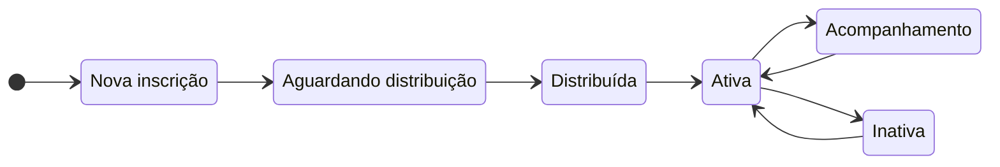
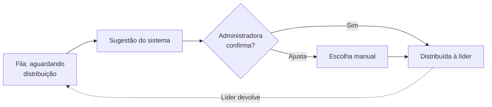
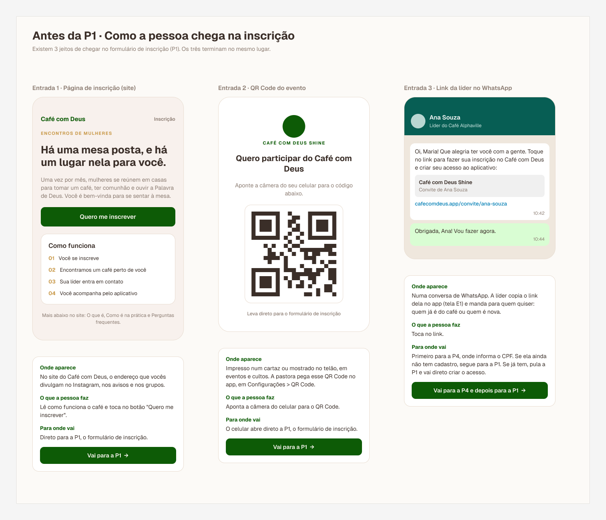
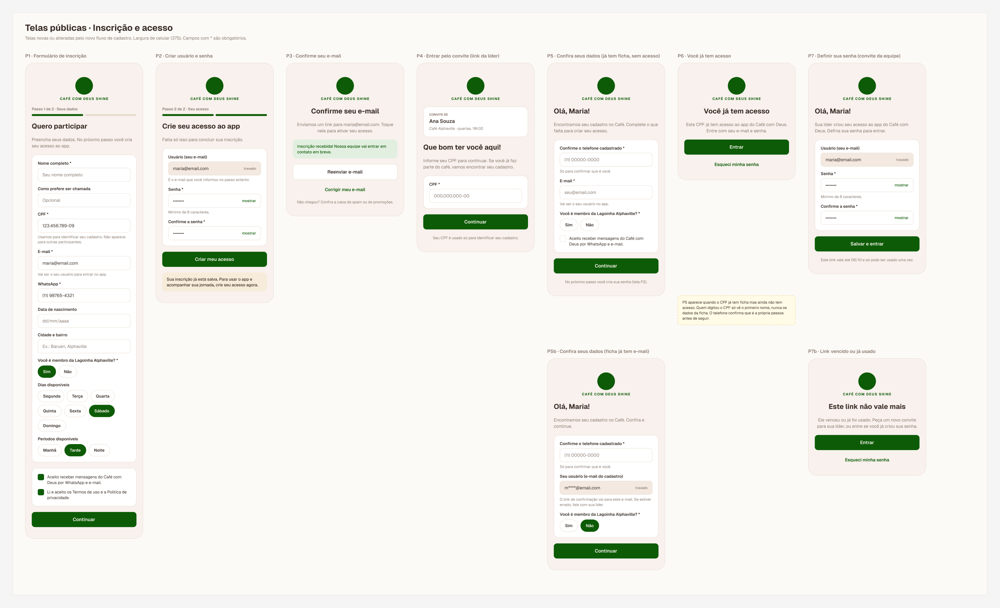
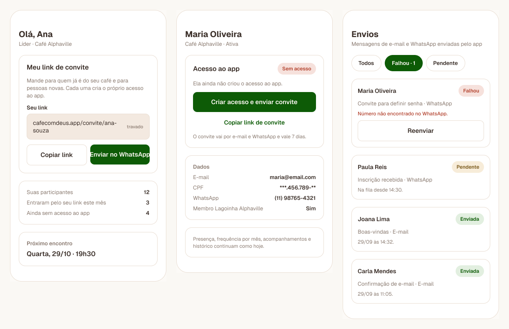
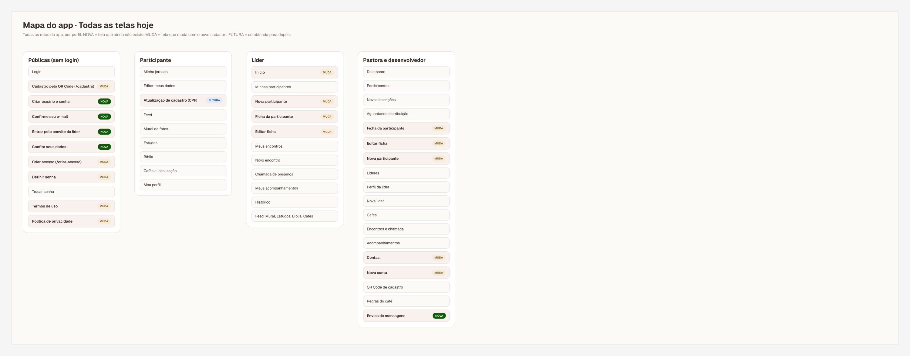

# Café com Deus Shine

**Uma plataforma para acompanhar cada participante de uma jornada de encontros, para que ninguém caminhe sozinha.**

| | |
|---|---|
| **Contexto** | Ministério cristão com jornada de encontros em casas, conduzidos por líderes |
| **Meu papel** | Product owner: visão do produto, perfis, jornada, regras, escopo do MVP e priorização. Desenvolvimento com apoio de IA, sob minha direção |
| **Usuários** | Administradora, líder, gestora de pessoas e, em etapa futura, participante |
| **Plataforma** | PWA, com prioridade para o celular, que é o dispositivo das líderes |
| **Stack** | Next.js, Supabase (com políticas de acesso por linha) e Netlify |

---

## O problema

Em uma jornada de encontros, o risco não é só "quem foi ao encontro". O risco é a pessoa que **deixa de aparecer e ninguém percebe**. A equipe precisava de mais do que cadastro e lista de presença: precisava **organizar participantes por líderes, saber quem precisa de atenção e manter o histórico de cada pessoa**.

A frase que orientou o produto, e que escrevi na especificação:

> "Não é apenas saber quem participou. É saber quem está caminhando conosco e cuidar para que ninguém caminhe sozinha."

## O que eu decidi

### 1. A participante tem uma jornada própria, independente dos encontros

Separei a **situação da pessoa** da **presença em um encontro**. A participante passa por estados, pode voltar a ser ativa, e **a distribuição para uma nova líder nunca apaga o histórico**.

### 2. Distribuição assistida, com decisão humana

Distribuir participantes entre líderes é uma tarefa administrativa que envolve localização, disponibilidade e capacidade. O sistema **sugere**, e a administradora **confirma ou altera**. A sugestão nunca muda nada sozinha.

Os critérios da sugestão seguem uma ordem de prioridade que defini: **1)** disponibilidade, **2)** proximidade, **3)** capacidade da líder, **4)** equilíbrio entre grupos, **5)** preferências cadastradas. Mantive o algoritmo simples de propósito, e a inteligência complexa ficou para uma fase futura.

### 3. Alertas que transformam presença em cuidado

O sistema aponta quem merece atenção:

| Situação | O que o sistema indica |
|---|---|
| Faltou a um encontro | "Precisa de contato" |
| Duas ou mais ausências seguidas | "Acompanhamento necessário" |
| Ativa, mas sem registro de acompanhamento por um período | "Sem acompanhamento recente" |

O prazo do terceiro alerta foi pensado para ser **configurável** no futuro.

### 4. Escopo do MVP com uma lista do que fica de fora

Tão importante quanto o que entrou é o que eu **decidi não fazer agora**: aplicativo nativo, chat interno, pagamentos, integração com WhatsApp, notificações push, geolocalização avançada, algoritmo complexo de distribuição, inteligência artificial e portal completo da participante. A arquitetura foi preparada para essas evoluções, mas o MVP ficou focado no essencial para a equipe: cadastro, distribuição, encontros, presença e acompanhamento.

### 5. Princípios de construção que escrevi na especificação

- Nada de telas apenas mockadas: as funcionalidades principais **conectadas ao banco** desde o início
- Evitar dados fixos no código e duplicação de lógica
- Separação clara entre **interface, regras de negócio, acesso a dados e autenticação**

### 6. Perfis com acesso mínimo necessário

Além da administradora e da líder, a evolução do produto mostrou a necessidade de um novo perfil, a **gestora de pessoas**, que cuida de novas inscrições, fila de distribuição e redistribuição, **sem acesso** a contas, auditoria ou configurações, e sem poder apagar dados. O princípio foi dar a cada perfil só o acesso de que ele precisa.

### 7. Segurança tratada como parte do produto

O banco tem políticas de acesso por linha, e as migrações incluem **limitação de tentativas de login, registro de auditoria de autenticação, revogação de sessões** e a correção de uma falha de escalonamento de privilégio de perfil. Como o sistema lida com dados pessoais de participantes, tratei isso como requisito, e não como detalhe técnico.

## As telas, desenhadas no Figma

Desenhei o fluxo de inscrição e acesso no Figma antes de implementar. Os dados das telas são fictícios.

**Três jeitos de chegar ao mesmo formulário.** A pessoa pode chegar pela página de inscrição do site, pelo QR Code do evento ou pelo link que a líder manda no WhatsApp. Os três terminam na mesma tela de inscrição.

**Telas públicas, da inscrição ao acesso.** Inscrição em 2 passos (dados e depois acesso), confirmação de e-mail, entrada pelo convite da líder, confirmação de dados quando a pessoa já tem ficha e definição de senha pelo convite da equipe. Também desenhei os casos de erro, como o link vencido ou já usado.

**Telas da equipe.** A líder tem um link de convite próprio, a ficha da participante mostra se ela está sem acesso, com convite enviado ou com acesso ativo, e uma tela de envios mostra as mensagens que falharam, as pendentes e as enviadas, com opção de reenviar.

**Mapa de todas as telas por perfil.** Marquei o que é tela nova, o que muda com o novo cadastro e o que fica para depois.

## Aprender com o uso

O feedback de uma líder virou melhoria concreta:

- **"A presença não aparece."** Investiguei e vi que o banco gravava corretamente: os encontros estavam marcados como "Realizado", mas **marcar como realizado não registra a chamada**, que é uma ação separada. A solução foi mudar o produto: agora a tela mostra **"Chamada pendente (x/y)"**.
- **A líder precisava enxergar a situação de cada participante na jornada**, então a tela dela ganhou um card de **situação** (ativa, em acompanhamento ou inativa).
- **A líder precisava poder devolver uma participante à fila** quando ela "precisa de outro café", e isso virou um fluxo próprio.

Depois do MVP, a plataforma também ganhou **leitura da Bíblia, mural de fotos e trilha de estudos**.

## Aprendizados

- **Quando o usuário diz "não funciona", o problema pode estar no desenho.** O dado estava salvo, mas a interface não deixava claro o que faltava fazer.
- **Dizer "não" por escrito protege o MVP.** A lista de itens adiados me ajudou a manter o foco e a alinhar expectativas.
- **Histórico nunca se apaga.** Preservar a trajetória da pessoa foi a regra mais importante do modelo de dados.

<!-- Resultado: acrescente aqui, se puder, 1 dado concreto (ex.: nº de participantes e líderes acompanhados, nº de encontros registrados). -->

---

[← Voltar ao portfólio](../../README.md)
