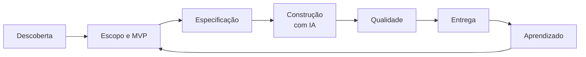

# Como eu trabalho

Meu processo de produto, do problema à produção, com exemplos reais dos [estudos de caso](README.md).

## 1. Descoberta: começo pelo problema, onde ele acontece

Entendo o processo com quem o executa. No [armazém](cases/01-armazem-gestao-de-paletes/README.md), o problema veio da minha própria rotina de almoxarifado. Nos demais, procuro entender o processo de quem usa, e onde estão as dificuldades, antes de desenhar a solução.

## 2. Escopo e MVP: decidir o que fica de fora

Cada MVP meu tem duas listas: o que entra e o que **não será feito agora**. No [Café com Deus Shine](cases/04-cafe-com-deus-shine/README.md), deixei explícitos o app nativo, o chat, a integração com WhatsApp e as notificações push, e preparei a arquitetura para recebê-los depois.

## 3. Especificação: escrever o produto antes de construí-lo

Descrevo perfis de acesso, jornadas, regras de negócio, alertas, critérios de aceitação e fases de desenvolvimento. É o que permite dirigir o desenvolvimento com precisão e passar o contexto para outra pessoa. No [SutoData](cases/02-sutodata-erp-industrial/README.md), por exemplo, cada perfil tem seu painel e suas regras, como a diferença entre ranking prévio e fechamento oficial.

## 4. Construção: IA sob direção

Eu não escrevo o código: **dirijo o desenvolvimento com IA**. Divido o pedido em tarefas, delego a agentes especializados (front-end, banco de dados e revisão) e defino o que é "pronto". A responsabilidade pelo produto, pelas decisões e pela qualidade é minha.

## 5. Qualidade: regras explícitas

- **Revisão obrigatória** antes de publicar, com número máximo de ciclos
- **Teste de regressão** para cada bug corrigido: precisa falhar antes e passar depois
- **Simulação (dry run)** antes de mudanças estruturais ou destrutivas
- **Plano de rollback** antes de mexer em produção
- **Ambientes separados** de teste e produção

## 6. Entrega: o handoff faz parte do produto

Quando outra pessoa publica em produção, como no [Voluntários Lagoinha](cases/03-voluntarios-lagoinha/README.md), entrego um documento de alterações com o que mudou e o que verificar. Fluxos e telas ficam mapeados no Penpot.

## 7. Aprendizado: o uso real manda

Ajusto o produto com o que vejo no uso. Exemplo: quando uma líder disse que "a presença não aparecia", o dado estava salvo, mas a interface não deixava claro que a chamada era uma ação separada. A solução foi mudar o produto, e não explicar ao usuário.

---

[← Voltar ao portfólio](README.md)
