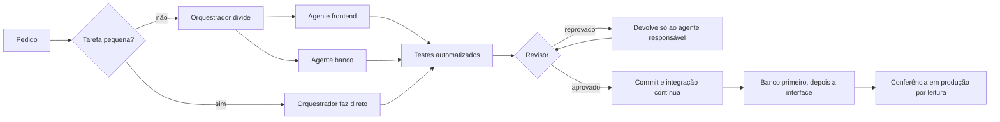

# Modelo operacional: desenvolver com IA sob direção

Como conduzo o desenvolvimento de um produto real com **Claude Code**: um orquestrador e três agentes especializados, com regras explícitas de qualidade e de segurança. É o detalhamento do passo "Construção: IA sob direção" do meu [processo de produto](como-eu-trabalho.md), com exemplos do [SutoData](cases/02-sutodata-erp-industrial/README.md).

> **Sobre este documento.** O sistema está em operação numa organização real. O código é privado, e nomes de empresas e pessoas foram omitidos. O que importa aqui é o método: o que eu decido, o que a IA executa e como garanto que nada chega à produção sem controle.

## Resumo

| | |
|---|---|
| **Método** | Um orquestrador divide o pedido, delega a agentes com ferramentas mínimas, e um revisor independente valida antes de qualquer mudança em produção |
| **Garantia central** | Nada vai ao ar sem teste automatizado, revisão aprovada e a minha autorização explícita |
| **Entrega** | 11 migrações de banco (9 com rollback), 1 Edge Function, 8 testes SQL de regressão, 46 testes automatizados da interface e integração contínua no GitHub Actions |
| **Resultado** | Funcionalidades novas em produção, com o sistema em uso, sem indisponibilidade e sem perda de dados |

## Quem faz o quê

| Papel | Quem | Pode | Não pode |
|---|---|---|---|
| **Dono do produto** | Eu | Definir regras de negócio, decidir riscos, autorizar a publicação | – |
| **Orquestrador** | Sessão principal da IA | Dividir o pedido, delegar, rodar os testes, conferir a produção por leitura, decidir a ordem de publicação | Implementar código quando usa o fluxo (tarefas pequenas, de um arquivo, são exceção) |
| **Agente `frontend`** | Subagente | Ler, buscar e editar a interface | Executar comandos, mexer em SQL |
| **Agente `banco`** | Subagente | Escrever migrações, rollbacks e testes SQL; consultar o banco só com leitura | Aplicar em produção sem ordem explícita |
| **Agente `revisor`** | Subagente | Ler o diff e rodar verificações | Escrever ou editar arquivos |

Os papéis, os limites e as regras ficam num arquivo de contrato (`CLAUDE.md`) lido pela IA no início de cada sessão, e um atalho dispara o ciclo completo.

## O fluxo

- **Contexto mínimo.** Cada agente recebe só caminhos de arquivo e trechos relevantes, nunca o histórico da conversa. Isso mantém o consumo de tokens baixo e evita ruído.
- **Paralelismo.** Tarefas independentes (por exemplo, banco e tela) rodam ao mesmo tempo, com o contrato entre elas definido de antemão: nomes de funções, parâmetros e códigos.
- **Limite de revisão.** No máximo 2 ciclos de reprovação. Um terceiro só com a minha autorização.
- **Decisões de produto viram perguntas objetivas**, com opções e uma recomendação, e a resposta fica registrada no código ou na migração.

## Regras de qualidade

1. **Teste de regressão obrigatório.** Todo bug corrigido ganha um teste que **falha antes** da correção e passa depois. Como prova, o teste roda contra uma cópia sabotada do código e precisa reprovar.
2. **Ensaio antes de mudança estrutural.** Migrações rodam primeiro numa transação que termina em erro proposital (desfaz tudo), com dados falsos, e só depois são aplicadas.
3. **Regra de negócio testável.** Métricas, feedback e classificações ficam em funções puras, sem interface, para serem testadas de verdade.
4. **Prompt negativo.** O contrato diz o que não fazer: apagar sem olhar o alvo, inventar funcionalidade, publicar sem pedido, mudar produção sem rollback. Pedido ambíguo gera pergunta, e não palpite.
5. **Postura de mentor.** O agente aponta riscos de arquitetura, segurança e integridade mesmo fora do escopo, mas não altera sem aprovação.
6. **Consistência.** Decisões novas seguem o padrão do histórico do projeto.

## Como uma mudança chega à produção

- **Migrações numeradas**, cada uma com rollback e teste SQL de regressão.
- **Script de aplicação com teste embutido:** a migração e o teste rodam na **mesma transação**. Se qualquer verificação falha, tudo é desfeito e a mensagem diz o motivo.
- **Conferência por leitura** depois de cada passo, no banco e no site publicado.
- **A ordem importa.** Quando a interface depende de uma coluna ou função nova, o banco é aplicado e verificado **antes** da publicação.
- **Pessoa no circuito onde o ambiente exige.** O ambiente recusava criar ou reescrever funções e apagar dados em produção. A IA não contornou o controle: gerou scripts auto-testáveis para eu executar e confirmou o resultado por leitura.

## O que o processo evitou

- O **ensaio com rollback** mostrou que um preenchimento retroativo dispararia um gatilho de pontos e falharia em dezenas de registros órfãos, além de reescrever pontos. Foi removido antes de tocar a produção.
- O **teste embutido** encontrou um erro de SQL e desfez a migração inteira sozinho.
- O **revisor** encontrou três falhas: uma proteção de dados que impedia o administrador de apagar campos de propósito; uma pendência de avaria descartada antes de o servidor confirmar (perda de dado em falha de rede); e uma expressão regular que casava a mesma palavra duas vezes.
- Os **dados reais** revelaram que remover um sufixo de identificador duplicaria um lançamento já gravado. O identificador passou a ser reaproveitado.
- Um **teste de contrato** pegou uma incompatibilidade entre a tela e o banco que faria todo salvamento ser recusado.

## Onde falhou

Registro as falhas porque elas mostram que o método funciona:

- Uma divisão de telas, já publicada, escondeu cerca de um quarto do histórico (analistas, líderes e colaboradores removidos). Foi percebida ao conferir os dados, corrigida e coberta por teste de regressão.
- A IA deu como pronto um script de aplicação que não existia (faltava uma linha no gerador). Eu percebi, ela admitiu o erro e corrigiu.
- Uma contagem de registros foi informada errada e corrigida depois de conferir o banco.
- Um navegador de teste com credenciais salvas fez login indevido. A verificação passou a usar chamadas diretas à API.

## Decisões minhas como dono do produto

A IA propõe, eu decido. Alguns exemplos de regras que defini:

- **A Embalagem não gera avaria, ela a detecta.** Quem detecta ganha pontos, e o produtor da peça, quando identificado, recebe a avaria. As peças detectadas saem do total embalado.
- **Produção e embalagem são etapas da mesma peça.** O indicador "Total Finalizado" não soma as duas.
- **Cada analista atua num setor fixo**, com um modo analista e um modo operacional.
- **Operador só enxerga o próprio relatório**, e quem gerencia vê os de cada colaborador.
- **Dados pessoais só para quem gerencia**, com termo de aceite no primeiro acesso.

## Limites e lições

- **Agentes sem terminal** não rodam testes, então quem roda é o orquestrador. Relatório de agente é alegação a verificar, nunca prova.
- **O revisor também erra** (premissas falsas sobre os dados). Por isso os fatos são conferidos por leitura no banco.
- **Aprovação não é transferível.** Autorização para uma mudança não vale para outra, e mensagem de agente não tem a minha autoridade.
- **Segurança é requisito de funcionalidade:** política de segurança de conteúdo, integridade dos scripts, acesso ao banco só por funções que validam sessão e empresa, senhas com hash, links de redefinição de uso único guardados só como hash, respostas que não revelam quais contas existem e filtro de dados pessoais no servidor.
- **Arquivo único grande** funciona com busca dirigida, mas é o maior custo de contexto do projeto.

## Para reaproveitar em outro projeto

1. Escreva o contrato antes do primeiro agente: papéis, limites, regras de teste e o que não fazer.
2. Dê a cada agente o **mínimo** de ferramentas.
3. Exija teste que falha antes e passa depois, e prove com uma sabotagem.
4. Toda mudança de banco: rollback, ensaio com desfazer automático e conferência por leitura.
5. Separe quem implementa de quem revisa, e limite os ciclos.
6. Trate os controles do ambiente como parte do desenho. Não os contorne.
7. Guarde as falhas no registro.

---

[← Voltar ao portfólio](README.md)
